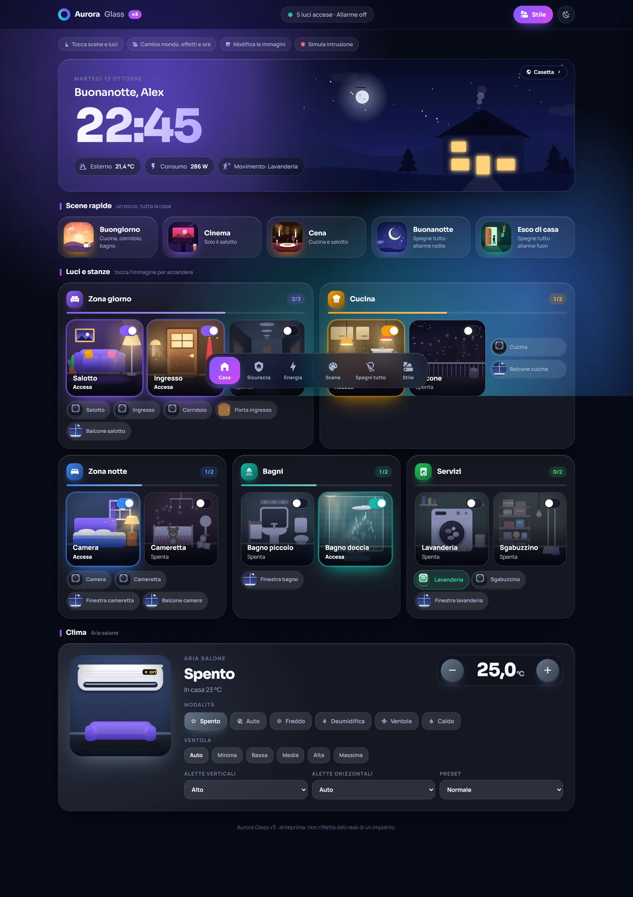
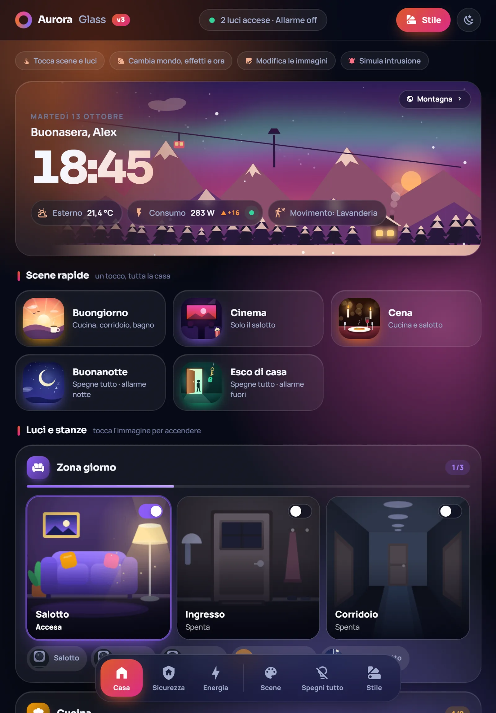
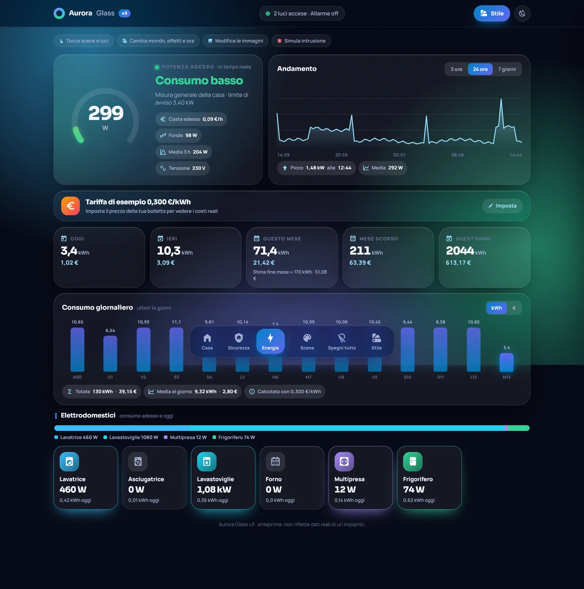
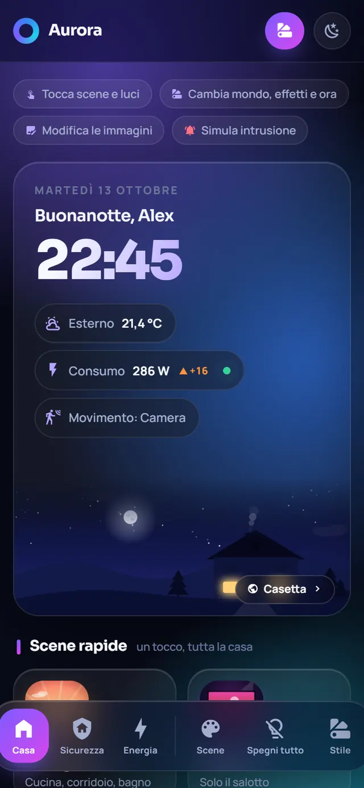

# Luma Home — Tableau de bord multilingue pour Home Assistant

[English](README.md) | [Français](README.fr.md) | [Italiano](README.it.md)

Version dérivée non officielle d’Aurora Glass v3, adaptée par Fonkyup avec une interface en français, en anglais et en italien.

> État du renommage : Luma Home est le nom public retenu pour cette documentation. Les instructions ci-dessous conservent les noms techniques actuels (`aurora-v3.js`, `custom:aurora-v3-card` et les dossiers existants). Ne les remplacez pas par `luma-home.js` ou `custom:luma-home-card` tant que le code et les fichiers distribués n’ont pas été migrés ensemble.



Une carte personnalisée qui transforme le tableau de bord de Home Assistant en une scène vivante : le ciel, le soleil, la lune et les fenêtres de la petite maison suivent l’heure réelle. Dix univers animés, onze effets météo, des boutons composés d’images et de GIF, une alarme, le contrôle du climat, des caméras et une vue Énergie calculant les coûts selon votre tarif.

## Origine et contributions

Cette version repose sur Aurora Glass v3, créé par DomotikPro.it (Luca Pinelli).

Mention originale conservée : © 2026 DomotikPro.it (Luca Pinelli).

Adaptation et traductions : Fonkyup.

Travail réalisé jusqu’au 25 octobre 2026 :
- ajout des traductions française et anglaise de l’interface ;
- adaptation des textes et messages dynamiques ;
- traduction française et anglaise du guide d’installation ;
- ajout de cette documentation et clarification de la provenance de la version dérivée.

L’italien du projet original est conservé. Cette version n’est ni une publication officielle ni une version présentée comme approuvée par DomotikPro.it ou Luca Pinelli.

Les captures ci-dessous proviennent du projet d’origine ; elles ne constituent pas une validation visuelle de toutes les traductions.

| Tablette | Énergie | Téléphone |
|---|---|---|
|  |  |  |

## Ressources du projet original

Ces liens concernent Aurora Glass v3, pas nécessairement la version traduite :
- Démonstration originale, en italien : https://domotikpro.it/aurora-glass-v3-demo/index.html
- Guide illustré original, en italien : https://domotikpro.it/progetti/aurora-glass-v3
- Vidéos de l’auteur original, en italien : https://www.youtube.com/@domotikproit
- Dépôt original : https://github.com/lucalux00/aurora-glass-v3

## Fonctionnalités

Fonctionnalités héritées du projet original :
- 10 univers animés et 11 effets météo : pluie, neige, orage, lucioles, pétales, feux d’artifice…
- Ciel suivant l’heure réelle.
- 50 images et GIF prêts à utiliser pour les boutons : éclairage, scènes, capteurs, alarme et climat.
- Panneau d’alarme, contrôle du climat et caméras.
- Vue Énergie : puissance, consommation en kWh d’aujourd’hui, d’hier, du mois et de l’année ; coût calculé par kWh × tarif.
- Carte distribuée sous la forme d’un fichier JavaScript, sans compilation nécessaire pour l’installation.

Ajout de cette version : sélection de la langue de l’interface par `language: fr`, `language: en` ou `language: it`.

## Confidentialité et connexions

Selon la documentation originale, la carte fonctionne localement et charge les polices Google Fonts Manrope et Sora par une requête externe. L’auteur indique qu’aucune donnée n’est collectée ni envoyée par la carte.

Cette description n’est pas un audit de sécurité ou du trafic réseau. Les intégrations Home Assistant utilisées pour vos appareils peuvent avoir leurs propres connexions externes.

## Installation de cette version

Les chemins ci-dessous correspondent à l’organisation actuelle des fichiers, avant leur éventuel renommage technique.

Le guide d’origine se trouve dans [LEGGIMI.txt](aurora-glass-v3/LEGGIMI.txt). Les commentaires des exemples YAML peuvent rester en italien.

### À propos de HACS

La procédure HACS du projet original utilise `lucalux00/aurora-glass-v3` : elle installe la version originale, pas cette adaptation.

La procédure HACS propre à cette version dérivée reste à valider. En attendant, utilisez l’installation manuelle ci-dessous et les fichiers de la branche contenant les traductions.

### 1. Copier les fichiers

Copiez le dossier `aurora-glass-v3/www/aurora-v3` dans le dossier `www` de votre configuration Home Assistant avec File editor, Samba ou Studio Code Server.

Vous devez obtenir :

```text
www/aurora-v3/aurora-v3.js
www/aurora-v3/btn/…
```

Si vous venez de créer le dossier `www`, redémarrez Home Assistant une fois.

Ouvrez `<adresse de Home Assistant>/local/aurora-v3/aurora-v3.js` dans le navigateur : du texte JavaScript doit s’afficher.

### 2. Ajouter la ressource

Dans votre profil, activez le Mode avancé.

Paramètres → Tableaux de bord → menu ⋮ → Ressources → Ajouter une ressource :
- URL : `/local/aurora-v3/aurora-v3.js?v=1`
- Type : Module JavaScript.

Augmentez le nombre après `?v=` lors des mises à jour. Si une ancienne installation existe, vérifiez les ressources avant d’en ajouter une autre pour éviter de charger deux versions de la même carte.

### 3. Créer le tableau de bord

Paramètres → Tableaux de bord → Ajouter un tableau de bord → Nouveau tableau de bord à partir de zéro.

Titre suggéré : `Luma Home`.

### 4. Coller la configuration

Ouvrez le tableau de bord → crayon → menu ⋮ → Éditeur de configuration brute.

Sur un nouveau tableau de bord, collez le contenu de [Exemple de tableau de bord](luma-home/dashboard-example.fr.yaml), puis enregistrez. Sauvegardez la configuration avant de remplacer celle d’un tableau de bord existant.

Les lumières restent grisées tant que vos entités ne sont pas renseignées.

### 5. Choisir la langue et associer les entités

Dans la configuration de la carte, conservez ses autres options et ajoutez la langue au même niveau que `type` et `assets` :

```yaml
type: custom:aurora-v3-card
assets: /local/aurora-v3/btn/
language: fr
```

Valeurs possibles : `fr` pour le français, `en` pour l’anglais, `it` pour l’italien. Sans option de langue, le code actuel utilise l’italien.

Outils de développement → États : trouvez vos identifiants d’entités et renseignez `entities:` conformément à [Options de la carte](luma-home/card-example.fr.yaml).

### 6. Configurer l’énergie — facultatif

Renseignez votre capteur de puissance en watts dans `energy.power`.

Pour les compteurs de consommation en kWh, consultez [Compteurs d’énergie](luma-home/aurora-energia.fr.yaml).

Dans la vue Énergie, ouvrez le réglage du tarif et indiquez votre prix par kWh. Les coûts affichés sont des estimations calculées à partir de la consommation et du tarif renseignés.

## Dépannage

- Message « Custom element doesn't exist » : vérifiez l’URL de la ressource et le type `custom:aurora-v3-card`, puis rechargez complètement la page.
- Images absentes : vérifiez que `assets` vaut `/local/aurora-v3/btn/`, avec la barre oblique finale.
- Lumières grisées : vérifiez l’identifiant de l’entité et sa disponibilité dans Home Assistant.
- Coûts à zéro : définissez le tarif et vérifiez les capteurs de consommation.
- Langue incorrecte : vérifiez `language: fr`, `language: en` ou `language: it`, ainsi que la version du JavaScript réellement chargée.
- Textes anciens après mise à jour : augmentez le paramètre `?v=` de la ressource et rechargez le navigateur.

## Désinstallation

Supprimez le tableau de bord concerné, sa ressource si elle n’est pas utilisée ailleurs, puis le dossier `www/aurora-v3` si aucune autre installation ne l’utilise.

Cette suppression ne décrit pas l’effacement des préférences stockées dans le navigateur ni le retrait des capteurs d’énergie ajoutés séparément.

## État et limites

L’interface française et anglaise a été vérifiée visuellement par le mainteneur. Tous les messages rares et tous les parcours ne sont pas nécessairement validés.

Le README d’origine indique qu’Aurora Glass v3 a été testé par son auteur sur Home Assistant 2026.9. Cette indication ne constitue pas une certification de cette version dérivée.

Pour un signalement sur cette adaptation, ouvrez une issue dans le dépôt où cette version est publiée, en précisant la langue, la version chargée et les étapes de reproduction.

## Licence et attribution

Le logiciel dérivé est distribué sous [GNU GPL version 3](LICENSE).

Vous pouvez utiliser, étudier, modifier et redistribuer le logiciel, y compris à des fins commerciales, sous réserve des conditions de la licence. Les versions dérivées distribuées doivent notamment conserver les notices applicables, identifier les modifications et leur date, et respecter les obligations de licence et de fourniture du code source correspondant.

Mention originale conservée : © 2026 DomotikPro.it (Luca Pinelli).

Les contributions de Fonkyup ne remplacent pas les droits et les crédits du projet d’origine. Les éventuelles conditions propres aux composants tiers restent applicables.

Le nom Aurora Glass et la marque DomotikPro.it sont cités pour identifier le projet d’origine. Aucun droit de marque ni aucune approbation n’est revendiqué. Le nom public de cette version dérivée est Luma Home.

Le logiciel est fourni sans garantie, dans les limites de la licence et du droit applicable. Le texte intégral de LICENSE fait référence ; cette section n’en est qu’un résumé.

Le texte du fichier LICENSE doit être conservé sans modification. Les notices de projet et de contribution figurent dans la documentation et les fichiers source, pas à l’intérieur du texte de la GPL.

---

Projet d’origine : [DomotikPro.it](https://domotikpro.it) — Luca Pinelli.

Adaptation multilingue non officielle : Fonkyup.
